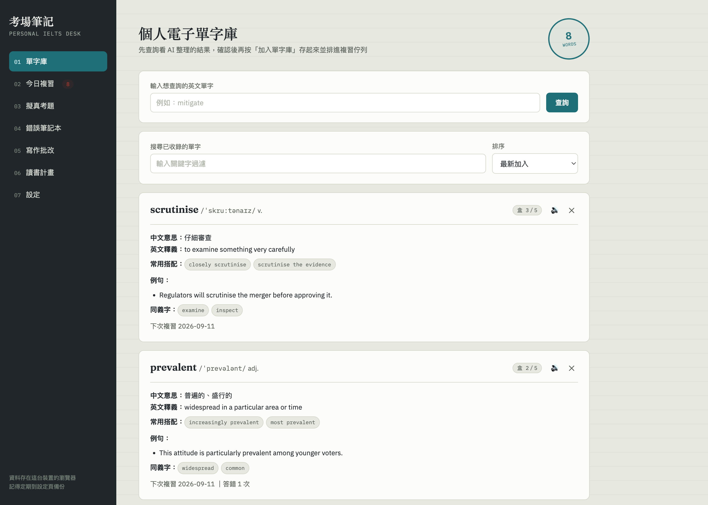
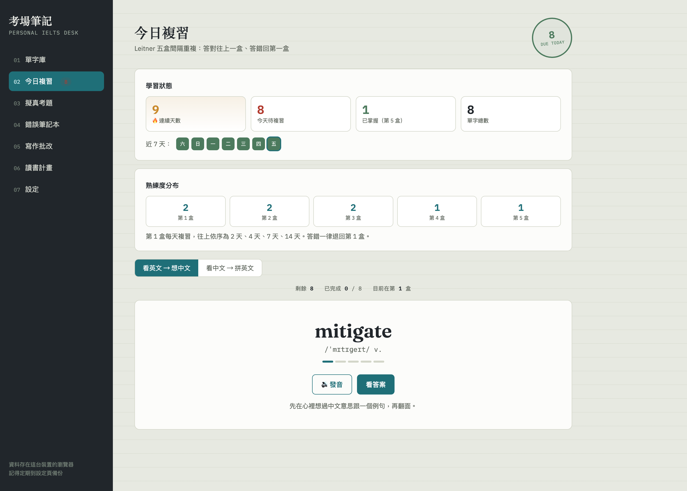

# IELTS Study Desk

[繁體中文](README.zh-TW.md)

Vocabulary I looked up, questions I got wrong and writing feedback, kept in one place — and it works out what I should review tomorrow.

**Live: [ielts-study-desk.pages.dev](https://ielts-study-desk.pages.dev)** — no signup required; your data stays in your browser.



Look a word up, check what came back, then add it — it's stored with its IPA, collocations and example sentences, and joins the review queue the same day.



The review page lays out the five Leitner boxes: a card in box one comes back the next day, then after 2, 4, 7 and 14 days. A wrong answer sends a card back to box one from wherever it was.

<sub>Both screenshots use demo data. The interface is in Traditional Chinese — I built this for myself and never wrote the English UI strings.</sub>

---

## Why I built it

While I was preparing for IELTS, my materials were scattered: words looked up on a translation site, practice questions in a paper notebook, essays pasted into an AI chat and gone the moment I closed the tab. Two days later I had no idea what I'd got wrong. Anki would have solved the scheduling, except that making the cards is exactly the chore that makes me quit.

What I wanted was one thing: **a word I look up becomes a review card on its own, a question I get wrong files itself into an error notebook, and something tells me which words are due today.** The apps I tried did vocabulary or did practice questions; none of them closed the loop from *input → mistake → review*. So I wrote one.

## What it does

- **Looking a word up is what creates the card.** Type an English word and Gemini returns IPA, meanings in English and Chinese, collocations, example sentences, synonyms and a rough band estimate. You get a preview first — only "add to library" actually writes it and queues it, so a typo never pollutes the library.
- **Leitner five-box spaced repetition.** A right answer promotes a card one box, a wrong answer drops it to box one no matter where it was. Box intervals are 1, 2, 4, 7 and 14 days; a lapsed card is due again the same day and comes back once more in the same session.
- **Two review modes.** *Recognition* shows the English and asks for the meaning. *Production* shows the Chinese and makes you spell the English — the part recognition lets you bluff through.
- **Mistakes file themselves.** A wrong quiz answer — or any writing criterion scored 6.0 or below — goes into the error notebook with its skill and question subtype, feeds a weakness chart, and can be handed back to the model for a diagnosis.
- **Practice questions built from your own vocabulary.** Reading, writing, listening and speaking items generated from the words you've collected and the weaknesses you've accumulated. Listening items are read aloud by the browser's Web Speech API, with a switch between British and American English.
- **Cross-device sync is optional.** With no account, everything stays on the device. With one, the whole state syncs to Cloudflare D1, under optimistic locking so two devices can't quietly overwrite each other.

## Running it

The quickest way in is the [live site](https://ielts-study-desk.pages.dev). To read the code and run it locally:

```bash
git clone https://github.com/seanlu2006/ielts-study-desk.git
cd ielts-study-desk
open ielts.html          # xdg-open on Linux, start on Windows
```

The frontend is a single HTML file, so double-clicking it works: the interface and everything held locally (vocabulary, review, error notebook) are fully usable. `/api` doesn't exist under `file://`, so cloud sync is switched off there.

The tests need nothing beyond the dev dependencies:

```bash
npm install
npm test    # 104 jsdom checks; nothing hits a real API or a database
```

For the full environment (frontend + API + local D1):

```bash
# create the local D1 database (first time only; not needed for npm test)
npx wrangler d1 execute ielts-progress --file=./schema.sql --local

npm run dev # frontend + Pages Functions + local D1
```

The AI features need your own Gemini API key from [Google AI Studio](https://aistudio.google.com/apikey), pasted into the site's Settings page. It's held in your browser and never passes through my server.

Deploying your own copy — creating the D1 database, loading the schema, setting `TOKEN_SECRET` — is written out step by step in [`DEPLOY-backend.md`](DEPLOY-backend.md). The `database_id` in `wrangler.toml` is mine; replace it with the one your own `wrangler d1 create` prints.

## How it's built

| Layer | Choice |
|---|---|
| Frontend | one HTML file, vanilla JS — no framework, no bundler, no runtime dependencies. `build.mjs` is fifteen lines that copy `ielts.html` and `functions/` into `dist/` for deployment. |
| Local storage | `localStorage`. The synced state lives under one key, `ielts-app-state`; the login token and the review-mode preference are kept in separate keys on purpose. JSON export/import. |
| Backend (optional) | Cloudflare Pages Functions + D1 (SQLite) |
| AI | Google Gemini, called straight from the browser with the user's own key |
| Speech | Web Speech API |
| Tests | jsdom, 104 checks |

### A few decisions worth explaining

**Why one HTML file rather than React?**
This is a tool I use every day, not a product I plan to maintain for years. A framework adds a build step, dependency upgrades and a `node_modules` directory. It's one file: I can double-click it open, review vocabulary on a plane with no network, and hand the whole thing to a model when I want it read. The cost is real: 2,249 lines of HTML, CSS and JS in a single file. Past a certain size it has to be split — it isn't there yet.

**Why Cloudflare Pages + D1 rather than Node and Postgres?**
All I needed was a handful of endpoints, one users table and one progress table. A real server would be overkill. Pages Functions are same-origin with the frontend, so there's no CORS to handle; D1 is SQLite, so there's no new query language to learn; the free tier is far more than one person needs, and there's no machine to look after and nothing to fall over at 3am. The cost is the Workers runtime rather than Node, so native packages like `bcrypt` aren't available — password hashing is hand-rolled with Web Crypto's PBKDF2.

**Why users bring their own Gemini key?**
I'm not paying an API bill for everyone, and I don't want to hold anyone's key. It stays in the user's browser and talks to Google directly; my backend never sees it, and cloud sync strips it out of the uploaded state. The cost is that the key is exposed in the frontend, so it needs an HTTP referrer restriction in the Google Cloud Console to stop it being used elsewhere.

**Why optimistic locking on sync?**
The previous version synced through JSONBin on a last-write-wins basis. I'd finish a review session on my phone, then save once on my laptop and wipe the phone's progress. Now every upload carries a `version`; if it doesn't match, the server returns 409 along with the current cloud state, and the frontend adopts the cloud version and puts up an orange banner. It doesn't eat your data quietly. The actual trigger for adding a backend at all was iOS Safari: leave the site unopened for seven days and the system clears `localStorage`.

### How the data moves

```text
Looking up a word
  browser ──direct call──> Gemini API          (the key never touches my server)
          <──structured word data──
          └─> preview card ──"add"──> localStorage['ielts-app-state']
                                        └─> Leitner queue, nextReview scheduled

Sync (optional, once signed in)
  localStorage ──PUT /api/progress { state, version }──> Pages Function
                                                            └─> D1 progress table
                                                                 writes only if version matches
                                <──409 + current cloud state──  blocked if it doesn't
```

### How accounts work

The backend is three endpoints: `POST /api/register`, `POST /api/login`, `GET|PUT /api/progress`.

- Passphrases are never stored in the clear — only as a PBKDF2-HMAC-SHA256 hash, 100,000 iterations, with a per-user salt
- The login token is a stateless HMAC-SHA256 signature valid for 30 days, so there's no session table to keep
- Hash comparison is constant-time, and a dummy hash is computed even when the account doesn't exist, so response timing doesn't reveal which usernames are real
- `TOKEN_SECRET` is set with `wrangler pages secret put` and never enters version control

## Project layout

```text
ielts.html              the entire frontend: CSS, JS and all seven modules in one file
functions/api/
  ├── _lib.js           shared backend: PBKDF2 hashing, token signing/verification, HTTP helpers
  ├── register.js       create an account; returns a token on success
  ├── login.js          verify a passphrase; returns a token
  └── progress.js       read/write progress; PUT is optimistically locked, 409 on conflict
tests/                  jsdom tests, run in numbered order by npm test, 104 checks total
schema.sql              D1 tables: users + progress
wrangler.toml           Cloudflare Pages and D1 binding config
build.mjs               produces dist/: ielts.html renamed to index.html + functions/
DEPLOY-backend.md       step-by-step first-time backend setup
CLAUDE.md               constraints for AI collaborators (every trap I've hit is written down there)
```

## Known limitations

- **There's no speaking practice.** The quiz generator produces speaking prompts and the error notebook has a speaking category, but both are text only — nothing records or scores your voice. That needs `MediaRecorder` plus a grading call that accepts audio — an order of magnitude more work than the other modules, so I haven't built it.
- **The backend has no automated tests.** All 104 checks cover the frontend; registration, login and the 409 conflict path are verified by hand with `npm run dev`. This is the gap I most want to close.
- **Sync conflicts are "cloud wins, loudly", not a real merge.** If two devices edit at once, the later upload is told to adopt the cloud version and that device's unsynced change is lost — with a banner, not silently. Doing better means field-level merging.
- **The mobile layout breaks below roughly 400px.** At 375px the sidebar collapses into a horizontal strip where each nav label wraps to one character per line, and the header eats most of the space above the fold. The `@media (max-width:800px)` block needs rewriting.

## License

[MIT](LICENSE)
